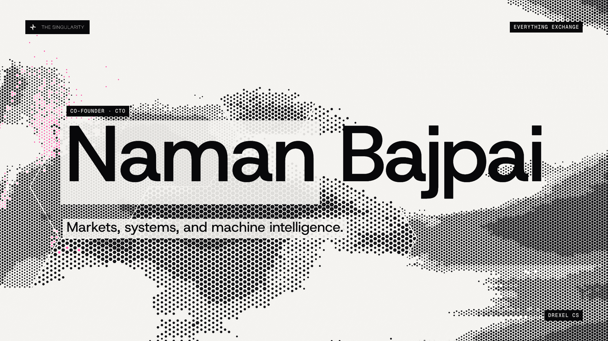
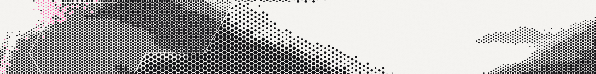

<picture>
  <source media="(prefers-color-scheme: dark)" srcset="assets/hero-dark.png">
  
</picture>

  
  
  
  
  
  

I am the co-founder and CTO of **[The Singularity](https://github.com/0xTheSingularity)** (Entropy to Order), and I study Computer Science at Drexel University.

My work spans exchange infrastructure, GPU computing, distributed systems, compilers, and applied machine learning.

https://github.com/user-attachments/assets/fc0e0fb6-556c-4bd1-a242-e840f58a9fa2

## Building The Singularity

We are building the **Everything Exchange**: a common system for trading across centralized exchanges and on-chain markets.

My work here spans **OneBook** for order management, routing, and execution; **Hilsa** for cross-chain observation and verification; and the matching, consensus, custody, and settlement infrastructure underneath them.

Execution, consensus, and market design

- **Execution and shared state:** GPU execution, shared-state systems, and tooling across multiple VM families. The [ETO CLI](https://github.com/0xTheSingularity/eto-cli) documents EVM, SVM, Move, WASM, and ZK interfaces.
- **Rohu-Paplet:** Byzantine consensus research, including the relationship between ordering, execution, observation, and finality.
- **Correctness and security:** EVM differential testing, failure testing, and adversarial protocol analysis.
- **Market mechanisms:** DRI and Asset Factory work on asset issuance and index tracking, and Orbital experiments in AMM design. The [DRI paper](https://github.com/0xTheSingularity/docs/blob/main/Math%20Paper%20DRI%20.md) documents the earlier design.
- **Interfaces and integration:** command-line and [MCP tooling](https://github.com/0xTheSingularity/eto-mcp), plus work connecting execution and consensus to persistent state, including QMDB integration.

## Selected engineering and research

| Area | Work |
| --- | --- |
| **GPU systems**   | Inference kernels for mixture-of-experts models and decode workloads. [FlashMap](https://github.com/bajpainaman/flash-map) is a bulk hash map in Rust with CUDA acceleration and CPU/Rayon fallbacks. |
| **Compilers and execution**   | [EVM-vx](https://github.com/bajpainaman/EVM-vx), a research-stage CPU EVM with optimistic parallel execution; [vex](https://github.com/bajpainaman/vex), a prototype package manager; and upstream [Vx compiler contributions](https://github.com/vx-lang/Vx/pulls?q=is%3Apr+is%3Amerged+author%3Abajpainaman). |
| **Custody and authorization**   | [Open Institutional Custody](https://github.com/0xTheSingularity/open-insititutional-custody): Rust components for payment approvals, spending limits, and EVM/Solana signing. A development preview with simulated chains. |
| **Verifier-guided learning**  | [Daybreak](https://github.com/bajpainaman/daybreak-demo): experiments in independent emulator checks, bug-finding workflows, and verifier-generated training data. [Interactive demo](https://bajpainaman.github.io/daybreak-demo/). |
| **Strategic reasoning**   | [Sigma-Go](https://github.com/bajpainaman/scaling): research on counterfactual value prediction, poker AI, and learning in imperfect-information games. |
| **Agents and open networks**   | [NANDA server and plugin integration](https://github.com/bajpainaman/Nanda-Sdk-Tsc), built on the MCP TypeScript SDK, and [Beckn AI tooling](https://github.com/bajpainaman/beckn-llm-layer) for developer assistance and retrieval. |

## Work in practice

- **Exelon / PECO:** GasGPT and production AI infrastructure for gas operations, including backend modernization supporting 1,000+ users.
- **Beckn Protocol:** an AI internship working on transaction interfaces and a knowledge-based developer assistant.
- **Drexel:** Computer Science, research, and teaching support.

Earlier ventures and applied ML

- **Encryptech / Mycelium:** decentralized and privacy-preserving machine learning, including federated learning and FHE. The public [architecture notes](https://github.com/bajpainaman/mycelium/blob/main/Architecture.MD) describe the federated-learning and Beckn direction.
- **Classcut / MPX:** educational software, video search, and ML product work.
- **Dynamic Rocketry:** earlier aerospace work on solid rocket motors and cold-gas thrusters.
- **[Delphic](https://github.com/bajpainaman/delphic):** API-to-chain oracle experiments, with contracts, off-chain ingestion, and TEE-oriented components.
- **[Indic LLM Toolkit](https://github.com/bajpainaman/indic-llm-toolkit):** data preparation, training, evaluation, and inference experiments for multilingual models.
- **[Insurance ML](https://github.com/bajpainaman/insurance_c):** experiments combining tabular, graph, text, and anomaly-detection models.

Developer tools and technical explorations

- **[DeltaMCP](https://github.com/bajpainaman/DeltaMCP):** git-delta integration for readable diffs and Git views in coding assistants.
- **[STE writing](https://github.com/bajpainaman/ste-writing):** technical-writing tools with agent edit hooks and Vale/Harper linting.
- **[Jev / Codex integration](https://github.com/bajpainaman/fast-jev-compaction/blob/main/CODEX.md):** a Codex history adapter and post-compaction context restoration contributed in my fork.
- **Research forks:** [Solidus](https://github.com/bajpainaman/solidus), for Lean 4 and Yul-to-EVM compilation, and [strevm](https://github.com/bajpainaman/strevm), for streaming asynchronous EVM execution.

## Milestones

  
  
   
  
  

## Tools

  
  
  
  
   
  
  
  
  

<picture>
  <source media="(prefers-color-scheme: dark)" srcset="assets/wall-dark.webp">
  
</picture>
